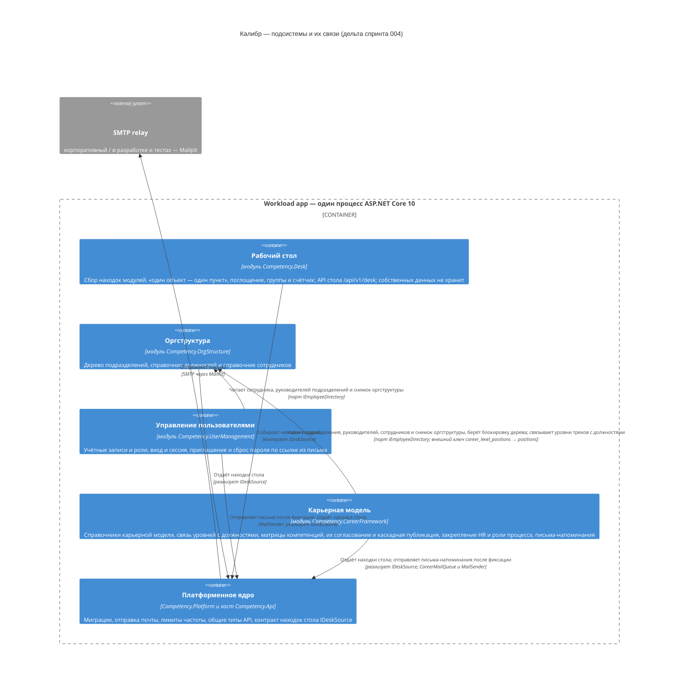

---
responsibility:
  owns: which subsystems exist and their ids (sole subsystem registry); diagram_tool mermaid: the subsystem diagram
  excludes: a subsystem's purpose and key paths, requirements, decisions, stack
  delegates_to: <id>.md (purpose, key paths), c4/ (likec4 diagram source), stack.html
---

# Subsystems

Дельта спринта 004 к `docs/architecture/subsystems.md`, применяется на design-promote. Метки: **[+]** — новый элемент, **[~]** — изменённый (прежний текст — в строке «было»), **[=]** — контекст без изменений, нужен только для отрисовки. Всё, что здесь не названо, остаётся как в постоянном документе. Источник — ADR-1…ADR-6 (`design/adr.html`), подсистема `desk` одобрена пользователем 2026-10-13 (decisions-log).

| Id | Name | Role |
|---|---|---|
| **[+]** [desk](./desk.md) | Рабочий стол | Ожидаемые действия пользователя из всех подсистем: сбор находок модулей через контракт Platform `IDeskSource`, правило «один объект — один пункт», поглощение и порядок причин, группы, счётчик и API стола; экраны сценариев `/desk/…`; собственных данных не хранит |
| **[~]** [career-framework](./career-framework.md) | Карьерная модель | Профессиональные направления, карьерные треки и уровни со связью уровней с должностями оргструктуры, категории и каталог компетенций с историей версий, шкалы, версионируемые матрицы компетенций подразделений с маршрутом согласования и каскадной публикацией черновиков; закрепление HR за подразделениями и роли процесса (руководитель подразделения, ответственный HR); письма-напоминания участникам согласования |

Было (career-framework): «Профессиональные направления, карьерные треки и уровни, категории и каталог компетенций с историей версий, шкалы, версионируемые матрицы компетенций подразделений с маршрутом согласования; закрепление HR за подразделениями и роли процесса (руководитель подразделения, ответственный HR)».

Строки `org-structure`, `user-management`, `audit` и абзац о `Competency.Platform` и `Competency.Api` не меняются.

## Diagram

Абзац об узлах `platform-core`, `postgres` и `smtp-relay` не меняется. В блоке ниже — только новые и изменённые элементы плюс узлы контекста **[=]**, на которые они ссылаются; неизменённые связи (`audit`, `postgres`, порты `IEmployeeAccounts`, `IUserDirectory`, `Audited`) опущены. При переносе в постоянную диаграмму строки **[~]** заменяют прежние, строки **[+]** добавляются, комментарии `%%` не переносятся.

Связи `desk → org-structure` нет: `desk` зависит только от Platform (ADR-1). Снимок оргструктуры `FindOrgSnapshotAsync` (ADR-2) — новый метод уже нарисованного порта `IEmployeeDirectory`; его читают источники `career-framework` и `user-management`, это отражено в подписях их связей с `org-structure`. Связи `desk → postgres` нет: таблиц и миграций у `desk` нет.

## Предложение для `desk.md` (design-promote)

Новый `docs/architecture/desk.md` по `t_subsystem.md`; заголовок — «Рабочий стол (`desk`)». Id `desk` не зарезервирован и совпадает с префиксом маршрутов `/desk/…`.

**Purpose.** Рабочий стол — главная страница любого пользователя: собирает находки всех подсистем через контракт `IDeskSource` из Platform, сводит их в пункты по правилу «один объект — один пункт» (поглощение, порядок причин, группы) и считает пункты-действия для счётчика в шапке. Стол вычисляется на сервере при каждом запросе из текущих данных; собственных таблиц, миграций и кэша у подсистемы нет. Модуль зависит только от `Competency.Platform`; модули о нём не знают.

**Key paths.**

- `src/Competency.Desk/`: корень модуля; наружу — только `Add…Module` и `Map…Endpoints` (по соглашению модулей); слияние находок, таблицы поглощения и порядка причин в одном месте, группы, счётчик; методы `GET /api/v1/desk`, `GET /api/v1/desk/items`, `GET /api/v1/desk/count`.
- `src/Competency.Platform/`: контракт находок — `IDeskSource`, `DeskFinding`, `DeskKind`, `DeskObjectType`; реализации — внутренние классы-источники в `org-structure`, `user-management` и `career-framework`, каждый модуль регистрирует свой в `Add…Module`.
- `web/src/features/desk/`: рабочий стол и экраны сценариев под `/desk/…`; маршруты — `web/src/features/desk/routes.ts`.
